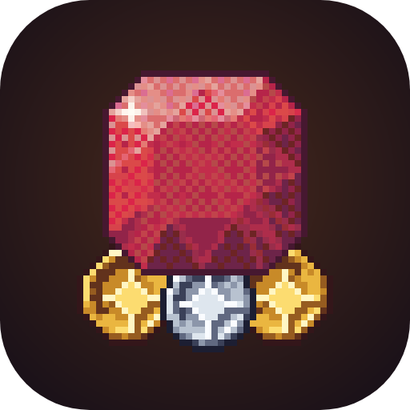
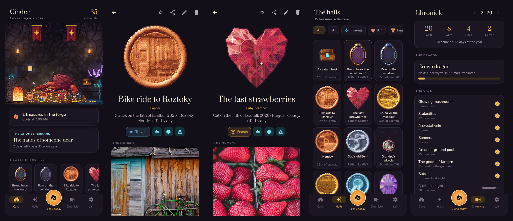

<div align="center">



# Hoard

### Сокровищница дракона из твоих моментов

*Фото и короткие клипы, отчеканенные в пиксельные сокровища. Монета для обычного момента, самоцвет для особенного, реликвия для вехи, зеркало для клипа. Бесплатно, без рекламы и аккаунта.*

[](https://github.com/bigdevwhale/hoard/actions/workflows/android.yml)
[](https://github.com/bigdevwhale/hoard/releases/latest)


[](LICENSE)

[English](README.md) · **Русский** · [Изменения](CHANGELOG.md)



</div>

---

## Идея

Ты — дракон, а у дракона должна быть сокровищница. Твоя — из моментов. Каждый день ты относишь в пещеру несколько: камера ловит момент, горн превращает его в сокровище. Куча растёт, в пещере появляется новое, а дракон спит на ней и с каждым годом становится больше.

Это галерея, которая заставляет выбирать. **Три момента в день** (можно поменять), и **горн остывает за ночь**: то, что положил вечером, увидишь утром. Так проживаешь момент, а не разглядываешь его.

## Сокровища

Весь арт — пиксели, которые телефон рисует сам из твоего фото, поэтому двух одинаковых сокровищ не бывает:

| | Сокровище | Для чего | Как сделано |
|---|---|---|---|
| 🪙 | **Монета** | обычный момент | фото чеканится рельефом в золоте, серебре, меди или редких металлах; на обороте знак зала, руны дня и год |
| 💎 | **Самоцвет** | что-то особенное | фото поймано внутри огранённого камня: чётко в площадке, осколками в гранях. Наклони телефон — свет поползёт |
| 👑 | **Реликвия** | веха | корона, кубок, меч, амулет, рог, ключ, перстень или фонарь с моментом в медальоне |
| 🪞 | **Зеркало** | клип (до 5 с, из галереи до 30 с) | овальное зеркало, клип играет прямо в стекле |

## Что внутри

| | Функция | Как работает |
|---|---|---|
| 🔥 | **Горн** | Тап — фото, удержание — клип, или из галереи (со своей датой). Выбираешь, во что отчеканить, зал, имя и легенду. Горн остывает в 7:00 (или когда скажешь), тогда же одно тихое уведомление. |
| 🐉 | **Дракон** | Дай имя и выбери цвет. Он спит на куче и растёт от дракончика до древнего змея. Тапни: заворочается и выкатит старое сокровище — в первую очередь то, что было ровно год назад. |
| 🏰 | **Пещера** | Светящиеся грибы, сталактиты, кристальная жила, знамёна, подземное озеро, летучие мыши, павший рыцарь, окно в небо: всё появляется по мере роста сокровищницы. |
| 🏛️ | **Восемь залов** | Странствия, Близкие, Пиры, Звери, Небеса, Очаг, Подвиги, Диковины и фильтр любимого. |
| ᚱ | **Руны** | Место, погода и время суток на каждом сокровище (примерная геолокация + Open-Meteo, по желанию). |
| 🍄 | **Поручения гномов** | Раз в три дня гномы просят что-нибудь: «что-то серебряное», «дверь, которую хочется открыть». Принесёшь — заплатят материалами: розовое золото, мифрил, драконье стекло, звёздный металл, аметист, топаз, алмаз, лунный камень. |
| 🔒 | **Запечатанные сундуки** | Запри сокровище на месяц, год или до даты. До этого дня не посмотреть даже тебе. |
| 📜 | **Летопись** | Твой год по драконьему календарю (Снегостав … Листопад … Студень) и весь год книгой в PDF для печати. |
| 💾 | **Копия** | Один zip со всеми фото и клипами. Всё остальное не покидает телефон. |

## Приватность

Без аккаунта, аналитики и рекламы. Фото и клипы хранятся в памяти приложения, а не в общей галерее. Единственный сетевой запрос — к [Open-Meteo](https://open-meteo.com) за руной погоды, и только если руны включены.

## Сборка

```bash
./gradlew assembleDebug                 # app.hoard.dev рядом с настоящей установкой
./gradlew assembleDebug -Pdemo          # app.hoard.demo с выдуманной осенью в Праге
./gradlew testDebugUnitTest -Prender    # рисует арт и экраны в app/build/art
```

Демо-фото — с [Unsplash](https://unsplash.com) через [Lorem Picsum](https://picsum.photos) по лицензии Unsplash, попадают только в демо-сборку.

## Лицензия

[MIT](LICENSE) · часть [Stillcraft](https://bigdevwhale.github.io/stillcraft/)
